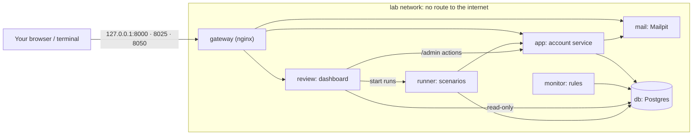

# Account Security Lab: User Guide

This guide covers everything you need to use the lab: starting it, running attack scenarios, turning defences on, and reading what happened in the logs.

**Contents**
1. [What the lab is](#1-what-the-lab-is)
2. [Safety rules](#2-safety-rules)
3. [Start the lab](#3-start-the-lab)
4. [The dashboard](#4-the-dashboard)
5. [Run scenarios](#5-run-scenarios)
6. [A first exercise, step by step](#6-a-first-exercise-step-by-step)
7. [Defences reference](#7-defences-reference)
8. [Monitoring rules reference](#8-monitoring-rules-reference)
9. [Look at the logs](#9-look-at-the-logs)
10. [Test the lab itself](#10-test-the-lab-itself)
11. [Try things by hand](#11-try-things-by-hand)
12. [Troubleshooting](#12-troubleshooting)
13. [Extend the lab](#13-extend-the-lab)

---

## 1. What the lab is

The lab is a fake account service (sign-up, login, MFA, passkeys, password reset, a small inventory you can trade) that records everything it does as telemetry. Around it sit:

- **Scenarios:** scripted suspicious activity (credential stuffing, a stolen session, a takeover…) replayed against the fake accounts.
- **Defences:** 15 on/off switches (rate limits, lockout, step-up codes, session binding, recovery hardening…).
- **Monitoring:** 13 detection rules that turn telemetry into alerts.
- **A dashboard:** to watch, compare runs, respond, and flip defences.

The core loop is: **run a scenario → see what got through and what was detected → turn on a defence → run it again → compare.**



| Service | What it does | Reachable from your machine |
| --- | --- | --- |
| `gateway` | The only container connected to your machine. Forwards the three ports below, blocks `/admin`, strips simulated-origin headers. | yes |
| `app` | The fake account service (FastAPI). Applies database migrations at startup. | via gateway, `127.0.0.1:8000` |
| `mail` | Mailpit: catches every email (reset tokens, step-up codes, notices). | via gateway, `127.0.0.1:8025` |
| `review` | The dashboard (Streamlit). | via gateway, `127.0.0.1:8050` |
| `runner` | Runs scenarios. Refuses any target other than `app`. | no |
| `monitor` | Runs the detection rules every 2 seconds. | no |
| `db` | Postgres: the app's tables (`app.*`) and telemetry (`telemetry.*`). | no |

## 2. Safety rules

The lab is built so the attack simulations can't leave it:

- Every container except the gateway sits on an internal Docker network with **no route to the internet**. `scripts/check_isolation.py` proves it.
- The scenario runner only accepts `http://app:8000` as a target.
- All accounts are fake (`@lab.test`, a reserved domain). Simulated IPs come from documentation ranges (`192.0.2.x`, `198.51.100.x`, `203.0.113.x`).
- Everything listens on `127.0.0.1` only, so nothing is exposed to your network.

Keep it that way: never use real credentials, real people's data or real breach dumps, and never point any of this at a system you don't own.

## 3. Start the lab

### Requirements
- **Docker Desktop** (WSL 2 engine on Windows).
- **Hardware virtualization turned on** in the BIOS/UEFI. Without it, Docker's engine never starts (see [Troubleshooting](#12-troubleshooting)).
- About 2 GB of free disk space for images.

### First start
From the project folder:

```bash
docker compose up -d --build
```

Wait until every service is up, which takes 1–3 minutes the first time:

```bash
docker compose ps
```

Check the lab is sealed off from the internet. It must print `ISOLATED`:

```bash
docker compose exec app python scripts/check_isolation.py
```

Create 20 fictional accounts with items (optional; scenarios create their own accounts):

```bash
docker compose run --rm seed
```

The seed writes the test credentials to `data/out/seed_accounts.csv` (git-ignored). Use them to sign in by hand.

### Open the lab

| What | Where |
| --- | --- |
| Dashboard | http://127.0.0.1:8050 |
| API with interactive docs | http://127.0.0.1:8000/docs |
| Emails (reset tokens, sign-in codes, notices) | http://127.0.0.1:8025 |
| Passkey test page | http://localhost:8000/lab/passkeys (must be `localhost`) |

### Stop, restart, reset

Stop the lab and keep its data:

```bash
docker compose down
```

Start it again:

```bash
docker compose up -d
```

Wipe all data (accounts, telemetry, alerts) and start fresh:

```bash
docker compose down -v
```

After changing code, rebuild:

```bash
docker compose up -d --build
```

## 4. The dashboard

Open http://127.0.0.1:8050. The sidebar sets the **time window** and a **Run** filter (all events, untagged only, or one run id). It also shows whether monitoring is on.

| Tab | Use it to |
| --- | --- |
| **Live** | Watch activity: login attempts, failures, source IPs, transfers and alerts; login outcomes over time; most-failed accounts; one combined feed of every event (logins, sessions, recovery, changes, transfers, alerts). Refreshes every 5 s. |
| **Scenarios** | Pick a scenario, read what it does, run it, and read its scorecard. Reopen any past scorecard. |
| **Accounts** | Inspect one account: status, MFA, passkeys, temporary lock, trade hold, live sessions, full timeline. Respond: lock/unlock, revoke sessions, force a password reset. |
| **Alerts** | Alerts by severity, with the rule, subject and evidence. |
| **Runs** | Every tagged run with counts; **compare two runs** side by side, including the defences that were on for each. |
| **Defences** | Turn each defence on or off (hover **?** for details). Every change is logged with a timestamp. |

The dashboard reads the database through a **read-only role** that can't see password hashes, MFA secrets or token hashes. Every action it takes goes through the app's `/admin` API, which the gateway blocks from your machine.

## 5. Run scenarios

### The 8 scenarios

| Scenario | What happens | Attacker goal | Should raise | Countered by |
| --- | --- | --- | --- | --- |
| `credential_stuffing` | Leaked email/password pairs tried on 16 accounts from 2 datacenter IPs; 4 users reused their password | Any session | `stuffing_many_accounts_one_ip`, `new_device_new_country`, `impossible_travel` | `risk.step_up` |
| `password_guessing` | 12 wrong passwords on one account, then the right one | Sign in | `guessing_one_account`, `success_after_failures` | `rate_limiting.per_account`, `lockout.enabled` |
| `mfa_bruteforce` | Password known; 8 wrong authenticator codes | Pass MFA (fails even with no defences: MFA holds) | `mfa_fail_burst`, `new_device_new_country`, `impossible_travel` | `rate_limiting.per_account` |
| `reset_flood` | 6 reset requests for one victim, then 8 other addresses from one IP | 5+ reset emails to the victim | `reset_burst` | `rate_limiting.per_account`, `rate_limiting.per_ip` |
| `impossible_travel` | Victim signs in from Montreal; their password is used from Bucharest seconds later | Sign in | `impossible_travel`, `new_device_new_country` | `risk.step_up` |
| `session_hijack` | Victim's session cookie replayed from another device, which then trades items away | Move items out | `session_hijack_suspected`, `asset_outflow_burst` | `session.bind_to_device`, `mfa.reauth_for_sensitive` |
| `account_takeover` | Stolen password used from abroad; email changed; every item moved to a mule account | Move items out | `new_device_new_country`, `impossible_travel`, `asset_outflow_burst` | `risk.step_up`, `recovery.trade_cooldown`, `mfa.reauth_for_sensitive` |
| `recovery_bypass` | Victim is passkey-only; attacker guesses the security answer, resets the password, cashes out | Move items out despite the passkey | `password_on_passkey_account`, `recovery_answer_guessing`, `security_question_recovery`, `recovery_then_change`, `asset_outflow_burst`, … | `recovery.block_security_questions`, `rate_limiting.per_account`, `recovery.trade_cooldown` |

Each run creates **its own fresh fake accounts**, plays the legitimate owner first (so the account has a normal history), and only then replays the suspicious part. Runs never interfere with each other or with the seed data.

### From the dashboard
**Scenarios** tab → pick a scenario → **Run scenario**. A run takes 1–10 seconds, plus up to a couple of seconds for monitoring to catch up.

### From the command line
The runner lives inside the lab, so use `docker compose exec runner …`.

List the scenarios:

```bash
docker compose exec runner python -m scenarios list
```

Run one:

```bash
docker compose exec runner python -m scenarios run credential_stuffing
```

Run one and print the full scorecard as JSON:

```bash
docker compose exec runner python -m scenarios run session_hijack --json
```

Run all eight:

```bash
docker compose exec runner python -m scenarios run-all
```

### Reading a scorecard

```text
> Account takeover and cash-out  [account_takeover-1a2b3c]
  verdict   Attack succeeded, and was detected
  goal      Move items out of the account: REACHED (6 item(s) moved)
  defences  monitoring.enabled
  blocked   nothing
  logins    success x2
  alerts    fired: asset_outflow_burst, impossible_travel, new_device_new_country
  run_id    account_takeover-1a2b3c  (1.9s)
```

| Field | Meaning |
| --- | --- |
| **verdict** | One of: *succeeded and was NOT detected* (worst), *succeeded and was detected*, *succeeded unseen because monitoring is off*, *blocked and detected*, *blocked*. |
| **goal** | What the simulated attacker wanted, whether they got it, and how far they got. |
| **defences** | The switches that were on when the run started (also stored with the run). |
| **blocked** | Attacker steps the app refused, by response code. `bad_password` and `unknown_account` are just wrong guesses. `rate_limited`, `step_up_required`, `session_revoked`, `reauth_required`, `trade_hold`, `recovery_method_disabled` and `account_locked` are defences at work. |
| **logins** | Every login result in the run, including the owners' normal logins. |
| **alerts** | Rules that fired for this run, plus any expected ones that didn't (`missing`). |
| **run_id** | Tags every event of the run. Use it in the dashboard's Run filter or in SQL. |

## 6. A first exercise, step by step

This walkthrough takes about 10 minutes and shows the whole loop on `account_takeover`.

1. **Baseline: no defences, no monitoring.** In **Scenarios**, run *Account takeover and cash-out*. Result: *Attack succeeded, unseen: monitoring is off.* Six items moved and nothing noticed.
2. **Turn on detection.** In **Defences**, turn on *Run detection rules* (`monitoring.enabled`). Run the scenario again. Result: *Attack succeeded, and was detected.* Open **Alerts**:
   - `impossible_travel`: the password was used ~7,500 km from the owner within seconds.
   - `new_device_new_country`: a device and country never seen on this account.
   - `asset_outflow_burst`: **critical**, because the items moved right after an email change.
3. **Investigate.** In **Accounts**, the victim is at the top, now named `taken-…@lab.test` because the attacker changed its email. Its timeline shows the whole story: owner login from CA, attacker login from RO with a risk score, `email_change`, then six transfers.
4. **Respond.** Click **Lock account** → Confirm. The attacker's session ends (`admin_lock` in the timeline).
5. **Prevent.** In **Defences**, turn on *Ask for a code on risky logins* (`risk.step_up`). Run the scenario again. Result: *Attack blocked, and detected.* The attacker's login got `step_up_required`: the app emailed a code to the real owner (see Mailpit), and the attacker never had it.
6. **Compare.** In **Runs**, pick the run from step 2 as A and the run from step 5 as B. The table shows the difference: transfers and the email change are gone, and `step_up` appears. The bottom table shows `risk.step_up` off in A and on in B.

Then try the same loop with the other scenarios. Each has its own write-up in [exercises/](../exercises/README.md).

## 7. Defences reference

All defences live in [`app/security/config.yaml`](../app/security/config.yaml), **all off by default** so you start from a baseline. Flip them in the dashboard's **Defences** tab so each change is logged. If you edit the file by hand, the app picks the change up right away, but it's only logged at the next app restart.

Passwords are always hashed with argon2; that is not a switch.

| Switch | Effect | Threshold | Main scenario |
| --- | --- | --- | --- |
| `baseline.password_policy` | Rejects short passwords and passwords containing the email name | 12 characters | (sign-up, reset, change) |
| `baseline.generic_errors` | Same reply for unknown account vs wrong password, and for reset/recovery on unknown emails | | account enumeration |
| `rate_limiting.per_account` | Failed logins per account → 429. Also caps MFA codes, wrong recovery answers, reset emails per account | 5 per 5 min; 5 codes; 5 answers / 10 min; 3 resets / 10 min | `password_guessing`, `mfa_bruteforce`, `reset_flood`, `recovery_bypass` |
| `rate_limiting.per_ip` | Failed logins per IP → 429. Also caps reset requests per IP | 20 per 5 min; 5 resets / 10 min | `reset_flood` (stuffing spreads its attempts across IPs to stay under it) |
| `lockout.enabled` | Wrong passwords in a row lock the account | 10 → locked 15 min | `password_guessing` |
| `breached_passwords.enabled` | Rejects passwords in `app/security/breached_sample.txt` (HIBP SHA-1 format) | | weak or reused passwords |
| `mfa.reauth_for_sensitive` | Email change, MFA disable, password-login change and trades need `POST /account/reauth` first | within 10 min | `session_hijack`, `account_takeover` |
| `session.secure_cookies` | Cookies get `Secure` and `SameSite=Strict` | | cookie theft and CSRF |
| `session.revoke_on_password_change` | Changing or resetting a password ends the other sessions | | lingering attacker sessions |
| `session.bind_to_device` | A session used from a different device fingerprint is ended | | `session_hijack` |
| `recovery.block_security_questions` | Turns off the weak security-question recovery | | `recovery_bypass` |
| `recovery.notify_on_change` | Emails the owner (old address) on password, email, MFA, passkey and recovery changes | | all takeovers (owner warning) |
| `recovery.trade_cooldown` | No trades after a reset, email change or recovery | 24 h | `account_takeover`, `recovery_bypass` |
| `risk.step_up` | Scores each password login; risky ones need an emailed code | new device +1, new country +2, datacenter IP +2, impossible travel +3; step-up at 3+ | `credential_stuffing`, `impossible_travel`, `account_takeover` |
| `monitoring.enabled` | Runs the 13 detection rules | every 2 s | all |

A risk score is computed and stored on **every** password login (`login_event.risk_score`, `risk_reasons`), even when `risk.step_up` is off. That way you can see what step-up *would* have done.

Accounts that turn on TOTP skip the emailed step-up: their authenticator code already is the second step.

## 8. Monitoring rules reference

List them from the command line:

```bash
docker compose exec monitor python -m telemetry.monitor --rules
```

Each rule looks back 10 minutes and fires at most once per subject (account, IP or session) every 30 minutes.

| Rule | Severity | Fires when |
| --- | --- | --- |
| `stuffing_many_accounts_one_ip` | high | One IP failed logins on 6+ different accounts |
| `guessing_one_account` | medium | 8+ failed or blocked password attempts on one account |
| `success_after_failures` | high | A correct password after 5+ wrong ones on the same account (15 min) |
| `impossible_travel` | high | Two password-correct logins over 500 km apart at over 900 km/h |
| `new_device_new_country` | medium | Password-correct login from a device **and** country never seen on the account |
| `password_on_passkey_account` | medium | A password was tried on a passkey-only account (the old password is known) |
| `session_hijack_suspected` | critical | A session was used from a device other than the one that created it |
| `mfa_fail_burst` | high | 5+ wrong second-step codes on one account |
| `reset_burst` | medium | 5+ reset requests for one account, or 8+ from one IP |
| `recovery_then_change` | high | Email or MFA changed within 30 min of a password recovery |
| `asset_outflow_burst` | high / **critical** | 4+ transfers or $500+ out of one account. Critical after a sensitive change or session anomaly |
| `security_question_recovery` | medium | A password was reset through a security question |
| `recovery_answer_guessing` | medium | 3+ wrong security-question answers on one account |

The rules are SQL over the telemetry tables, in [`telemetry/monitor.py`](../telemetry/monitor.py). Reading them is a good way to learn what each attack looks like in data.

## 9. Look at the logs

There are four places to look, from easiest to most detailed.

### 9.1 The dashboard
- **Live → Event feed:** everything, newest first. Filter by event kind.
- **Sidebar → Run:** pick a run id to see only that run's events, everywhere.
- **Accounts → Timeline:** one account's full story.
- **Alerts:** each alert's `evidence` column holds the numbers that triggered it.

### 9.2 SQL (the telemetry itself)
Open a database shell:

```bash
docker compose exec db psql -U lab lab
```

The telemetry tables (`\dt telemetry.*` lists them):

| Table | One row per | Key columns |
| --- | --- | --- |
| `telemetry.login_event` | login attempt (password, passkey, MFA, step-up) | `ts, account_id, email_attempted, ip, asn, ip_type, geo_country, device_fp, method, result, risk_score, risk_reasons, run_id` |
| `telemetry.session` | session | `session_id, account_id, login_event_id, started_at, ended_at, end_reason, device_fp, ip` |
| `telemetry.session_event` | request on a session from the wrong device | `session_id, device_fp, expected_device_fp, ip` |
| `telemetry.account_change` | security or profile change, admin action | `change_type, channel, detail, session_id` |
| `telemetry.recovery_event` | reset request or security-question attempt | `kind, email_attempted, result, ip` |
| `telemetry.asset_transfer` | trade | `account_id, counterparty, item_id, asset_value_cents` |
| `telemetry.device_fingerprint` | distinct device | `device_fp_id, first_seen, last_seen, seen_count` |
| `telemetry.alert` | alert raised | `rule_id, severity, subject, account_id, evidence, run_id` |
| `telemetry.scenario_run` | scenario run | `run_id, scenario, defences, scorecard` |
| `telemetry.defence_change` | defence switch flipped | `flag, enabled, actor, ts` |
| `telemetry.monitor_state` | (one row) monitoring heartbeat | `last_eval_at, enabled, alerts_raised` |

`login_event.result` values: `success`, `bad_password`, `unknown_account`, `locked`, `mfa_required`, `mfa_fail`, `step_up`, `rate_limited`, `password_disabled`, `passkey_fail`.

**Useful queries.** Paste them into psql.

The last 20 logins with risk:

```sql
SELECT to_char(ts, 'HH24:MI:SS.MS') AS t, email_attempted, host(ip) AS ip, geo_country AS cc,
       ip_type, method, result, risk_score, risk_reasons
  FROM telemetry.login_event ORDER BY ts DESC LIMIT 20;
```

Everything one run did, in order (replace the run id):

```sql
SELECT ts, 'login' AS kind, email_attempted AS who, result AS what, host(ip) AS ip
  FROM telemetry.login_event WHERE run_id = 'account_takeover-1a2b3c'
UNION ALL
SELECT ts, 'change', account_id::text, change_type, host(ip)
  FROM telemetry.account_change WHERE run_id = 'account_takeover-1a2b3c'
UNION ALL
SELECT ts, 'transfer', account_id::text, 'item ' || item_id || ' ($' || asset_value_cents / 100 || ')', host(ip)
  FROM telemetry.asset_transfer WHERE run_id = 'account_takeover-1a2b3c'
ORDER BY ts;
```

Which IPs failed on the most accounts in the last hour (the stuffing signature):

```sql
SELECT host(ip) AS ip, ip_type, count(DISTINCT email_attempted) AS accounts, count(*) AS attempts
  FROM telemetry.login_event
 WHERE ts > now() - interval '1 hour' AND result IN ('bad_password', 'unknown_account')
 GROUP BY 1, 2 ORDER BY accounts DESC LIMIT 10;
```

Alerts with their evidence:

```sql
SELECT ts, severity, rule_id, subject, run_id, jsonb_pretty(evidence)
  FROM telemetry.alert ORDER BY ts DESC LIMIT 10;
```

Scenario history at a glance:

```sql
SELECT run_id, scenario, scorecard ->> 'verdict' AS verdict,
       scorecard -> 'goal' ->> 'reached' AS goal_reached,
       scorecard -> 'alerts' -> 'fired' AS alerts
  FROM telemetry.scenario_run ORDER BY started_at DESC LIMIT 10;
```

Which defences were on, and when they changed:

```sql
SELECT ts, flag, enabled, actor FROM telemetry.defence_change ORDER BY ts DESC LIMIT 20;
```

Sessions used from another device:

```sql
SELECT ts, session_id, left(device_fp, 8) AS used_from, left(expected_device_fp, 8) AS created_on, host(ip)
  FROM telemetry.session_event ORDER BY ts DESC LIMIT 20;
```

### 9.3 Container logs
Every HTTP request the app receives, plus migration and startup messages:

```bash
docker compose logs -f app
```

Alerts as they are raised (`ALERT high impossible_travel account:…`):

```bash
docker compose logs -f monitor
```

The scenario runner and the gateway:

```bash
docker compose logs -f runner gateway
```

### 9.4 Mailpit (emails)
Open http://127.0.0.1:8025 to read every message the app sent:
- **Reset your Account Lab password:** a reset token (`POST /auth/reset/confirm`).
- **Your Account Lab sign-in code:** a step-up code after a risky login.
- **Account Lab security notice:** sent when `recovery.notify_on_change` is on.

## 10. Test the lab itself

| Command | What it proves | Time |
| --- | --- | --- |
| `docker compose exec app python scripts/check_isolation.py` | No container can reach the internet; internal services can reach each other | 10 s |
| `docker compose exec app python scripts/smoke_test.py` | Every account-service flow and the admin API work (39 checks) | 10 s |
| `docker compose exec runner python scripts/defence_test.py` | Each of the 14 enforcing defences, switched on alone, has its exact effect (17 checks) | 30 s |
| `docker compose exec runner python -m scenarios check` | All 8 scenarios succeed with defences off and are blocked with defences on, and the expected alerts fire | 1–2 min |

`defence_test.py` and `scenarios check` switch defences on and off while they run, then **put your settings back** when they finish.

You can also run the smoke test from your machine with Python 3:

```bash
python scripts/smoke_test.py
```

From your machine, the gateway strips the simulated-origin headers and blocks `/admin`, and the test checks that it does.

## 11. Try things by hand

### The API
http://127.0.0.1:8000/docs lists every route with a **Try it out** button. Sign in with an account from `data/out/seed_accounts.csv`.

### Simulated origins
Inside Docker every client shares one IP, so the lab lets in-lab clients describe a fake origin with headers. The gateway removes these headers from requests coming from your machine, so to use them, send requests from inside the lab:

```bash
docker compose exec runner python -c "
from scenarios.client import LabClient, datacenter
c = LabClient('http://app:8000', 'manual-test', datacenter('RO', 'my-test-box'))
print(c.post('/auth/login', {'email': 'someone@lab.test', 'password': 'nope-nope-nope'}).body)"
```

| Header | Example |
| --- | --- |
| `X-Lab-Sim-IP` | `203.0.113.10` |
| `X-Lab-Sim-ASN` | `64512` |
| `X-Lab-Sim-IP-Type` | `residential`, `datacenter`, `mobile` |
| `X-Lab-Sim-Geo` | `FR;48.85;2.35` (country;lat;lon) |
| `X-Lab-Sim-Device` | any label; changes the device fingerprint |
| `X-Lab-Run-Id` | tags every event (honoured from anywhere) |

### Passkeys with a real authenticator
1. Open **http://localhost:8000/lab/passkeys**. It must be `localhost`: browsers refuse passkeys on raw IP addresses like 127.0.0.1.
2. Sign in with a seeded account (email and password from `data/out/seed_accounts.csv`).
3. **Add passkey.** Windows Hello, your phone or a security key will prompt you.
4. **Turn password login off.** The account is now passkey-only.
5. **Sign out**, then **Sign in with passkey**.
6. Now try the weak recovery path on that account in the API docs: `POST /auth/recover/question/start`, then `POST /auth/recover/question` with the `security_answer` from the CSV. It works, and it turns password login back on. That is the Phase 5 lesson; `recovery.block_security_questions` closes it.

The scenarios use a built-in software passkey (`scenarios/softkey.py`) that produces the same WebAuthn messages a real device would.

## 12. Troubleshooting

| Symptom | Cause and fix |
| --- | --- |
| `failed to connect to the docker API … docker_engine` | Docker's engine isn't running. Start Docker Desktop and wait for *Engine running*. If it never starts, check *Virtualization Enabled In Firmware* in `systeminfo`: if it says *No*, enable Intel VT-x / AMD SVM in the BIOS. WSL 2 must be installed (`wsl --install --no-distribution`, then reboot). |
| `check_isolation.py` prints `NOT ISOLATED` | Don't run scenarios. Make sure you're using this repo's `docker-compose.yml` unchanged (`lab` must be `internal: true`, and only `gateway` may be on `edge`), then `docker compose down` and `up -d` again. |
| `port is already allocated` on 8000/8025/8050 | Another program uses the port. Stop it, or change the left-hand port in the gateway's `ports:` list. |
| Dashboard says it can't read the database | The app creates the read-only role at startup. Wait for `app` to be healthy (`docker compose ps`), then refresh. |
| Scenarios tab: *Scenario runner not reachable* | `docker compose ps runner`; if it's down: `docker compose up -d runner`. |
| Scorecard note: *Monitoring did not report back in time* | The `monitor` service is down or slow: `docker compose logs monitor`. |
| No alerts at all | `monitoring.enabled` is off. The sidebar shows the monitoring status. |
| Passkey page says passkeys don't work | You opened it on 127.0.0.1. Use `http://localhost:8000/lab/passkeys`. |
| Account stuck locked | Accounts → **Unlock account** (clears both admin locks and temporary lockouts). |
| You want a clean slate | `docker compose down -v`, then `docker compose up -d --build`, then `docker compose run --rm seed`. |

## 13. Extend the lab

**Add a scenario.** In [`scenarios/library.py`](../scenarios/library.py), write a function decorated with `@scenario(...)`:
- `run.account()` creates fresh fake accounts.
- `run.client(home(...))` or `run.client(datacenter(...))` gives you clients with a simulated origin.
- `run.attacker(response)` records each attacker step.
- `run.goal(reached, detail)` records the outcome.

Rebuild the runner (`docker compose up -d --build runner`). The scenario appears in the CLI and the dashboard, and `scenarios check` starts testing it.

**Add a detection rule.** In [`telemetry/monitor.py`](../telemetry/monitor.py), add a function decorated with `@rule(id, severity, description)` that yields hits with a `subject`, then rebuild the monitor (`docker compose up -d --build monitor`).

**Add a defence.** Add a switch to `app/security/config.yaml` (`true` = defence on), check it with `flags.enabled("section.name")` in the app, and add a case to `scripts/defence_test.py`. The dashboard picks the switch up automatically.

**Add a database change.** Add `telemetry/migrations/005_….sql`. The app applies it at its next start, without a reset.
